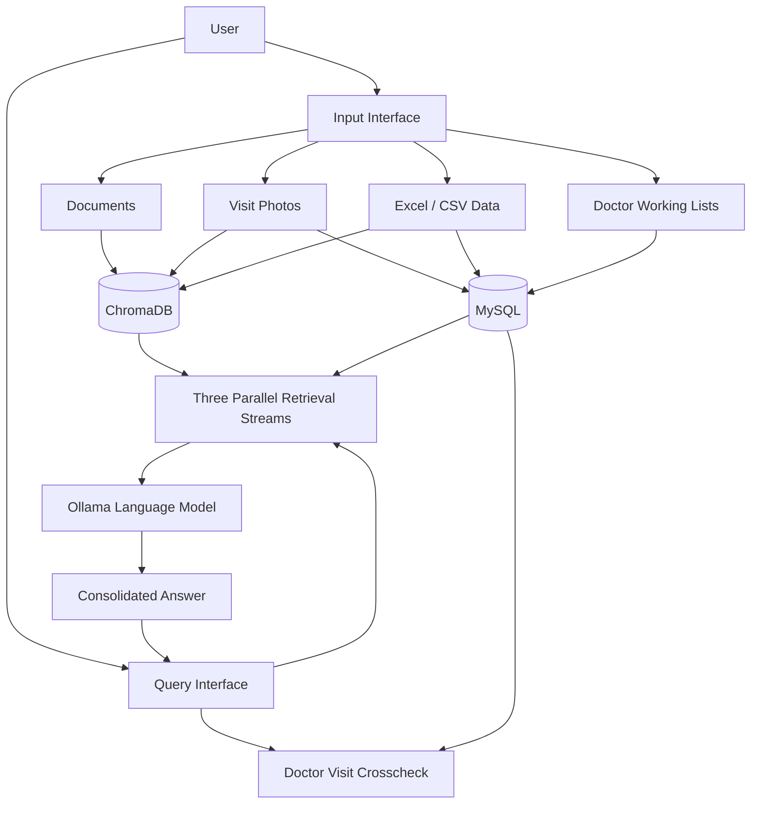

# RAG Chatbot

A knowledge assistant that lets users bring their own documents, photos, and spreadsheets together, then ask questions about that information in plain English.

Unlike a general chatbot that mainly relies on its pre-trained knowledge, this application first searches the data uploaded to it and uses the relevant results to prepare an answer.

## What it does

- **Ask questions across different data sources:** Search uploaded documents, image-based visit records, and spreadsheet data through one chat interface.
- **Work with documents:** Upload Word (`.docx`) and text (`.txt`) files so their contents can be searched later.
- **Organise and understand visit photos:** Store photos under representative profiles and extract useful visit details such as date, time, location, and GPS coordinates. Doctor names are associated using the image filename.
- **Bring spreadsheet data into the conversation:** Import Excel and CSV tables and ask questions about the information without manually writing database queries.
- **Crosscheck doctor visits:** Compare a representative's doctor working list with recorded visit photos to identify doctors met, not met, and visits that are not on the list.

## How it works

The application has two parts: an **Input interface** for adding and managing information, and a **Query interface** for asking questions about it.

When a user asks a question, the system searches three streams in parallel:

1. **Documents** – finds relevant passages from uploaded files.
2. **Images / Visits** – finds relevant records extracted from visit photos.
3. **Excel / SQL** – identifies the relevant spreadsheet table and retrieves the requested data.

The results are brought together by the language model to produce a single response.

## Built with

**Python · FastAPI · HTML/CSS/JavaScript · ChromaDB · MySQL · Ollama · PaddleOCR**

---

Created by [Navodit Kapoor](https://github.com/Navodit16)
